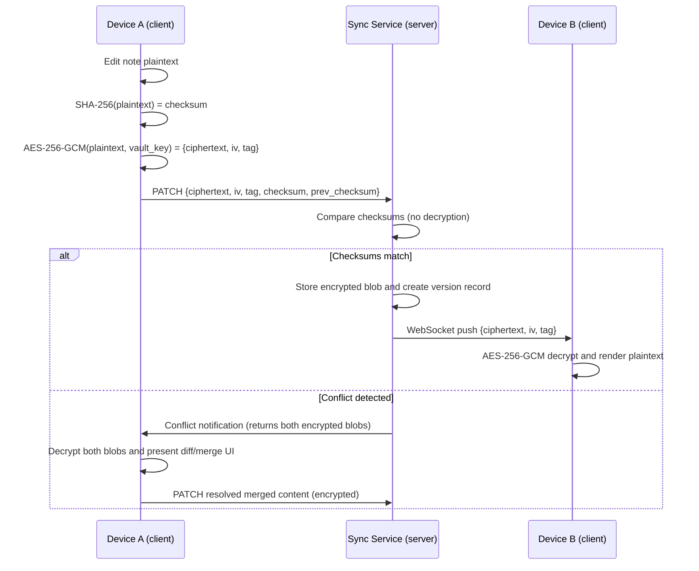

# Encryption Design - NexusNotes

This document defines the end-to-end encryption (E2EE) model for NexusNotes.
The server stores only opaque ciphertext. It is mathematically infeasible for
any party, including the server operator, to read note content without the
user's passphrase.

---

## Distinction between hashing and encryption

Hashing is a one-way transformation; the original data cannot be recovered.
Encryption is a two-way transformation; the owner holding the correct key can
always decrypt. Notes require encryption, not hashing.

SHA-256 hashing is used only for conflict detection checksums computed from
plaintext before encryption. It is not used to protect note content.

---

## Threat model

| Threat | Protected |
|---|---|
| Database breach - attacker reads PostgreSQL dump | Yes - only ciphertext is stored |
| Server operator access to stored data | Yes - server never holds the decryption key |
| Network interception | Yes - TLS in transit plus content encrypted at rest |
| Attacker with physical device access while vault is locked | Yes - key is held in memory only while vault is unlocked |
| User loses vault passphrase | Recoverable **only** with the one-time recovery key issued at setup; without both, data is unrecoverable — zero-knowledge means no backdoor |
| Weak passphrase and offline brute force | Mitigated by Argon2id (intentionally slow key derivation) |

---

## Encryption model - per vault, on by default

Vaults are either Encrypted (E2EE) or Standard. The user chooses at vault
creation time; end-to-end encryption is selected by default (#360). Turning it
off shows a short warning that the server could read the vault, with a
plain-language explanation on request. Standard vaults are still encrypted at
rest on the server (see [security.md](security.md#encryption-at-rest)), but the
server holds that key, so it is not zero-knowledge.

### Converting a standard vault (#361)

The owner of a standard vault can encrypt it later (Settings → Sync → *Encrypt
this vault*). The client generates the Vault Key and its wrapped forms exactly
as at creation, reads every note, encrypts each one on the device and sends all
of them in one request, titles and folder paths sealed as well (see below),
together with the vault's linked files.
The server swaps them in within a single transaction,
and only if it received exactly the vault's current notes (otherwise `409`, and
the client reads and encrypts again). In the same transaction it deletes what it
derived from the plaintext (stored versions, tags, aliases, links) and its search
documents are rebuilt with the sealed titles and paths only. The device that converted the
vault keeps the key in its session and shows the recovery code once; its local
drafts are deleted. Other devices receive `vault:encrypted`, drop the vault's
plaintext from memory and drafts, and ask for the passphrase.

A vault with attachments cannot be converted yet: its existing files were
stored readable by the server and would have to be re-encrypted too.

Nor can a vault whose Trash holds notes (#569): they are plaintext on the
server, but the client only encrypts the notes it can see, so they would stay
readable inside an e2ee vault. The server refuses with `409` ("Restore or empty
the Trash first") and leaves the trash as it is; it never deletes them on the
user's behalf. Once the notes are restored (and then converted with the rest)
or the trash is emptied, the conversion goes through. In an e2ee vault the
trash itself only ever holds ciphertext, like every other note.

### Linked files (#364)

A linked file's display name and source, and each member's annotations, are
sealed on the device in the same `e2ee:` format as note titles. A URL link is
still fetched through the server's proxy (browsers block cross-origin reads),
so opening one sends its decrypted URL with that single request; the server
fetches it and stores nothing. The server therefore learns which URL is opened
at the moment it is opened, but not the links a vault holds.

Converting a vault seals its links' names and sources in the same transaction
as its notes (#410). Annotations are per user, so the converting device cannot
seal the other members' ones: each member's client seals their own the next
time they open that link, and until then it stays readable to the server.

### Attachments (#238)

Files attached in an e2ee vault are encrypted on the device with the Vault
Key (AES-256-GCM, a random IV per file). Their original name and type are
encrypted as well and sent as the upload's file name,
`e2ee.<base64url(iv || ciphertext)>.bin`, so the server stores neither. After
download the client decrypts name, type and bytes and builds the blob with
its own safe type. The server refuses uploads to an e2ee vault whose name is
not of that form.

```
vaults.encryption = 'none'  -> existing behaviour, no change
vaults.encryption = 'e2ee'  -> all note content encrypted before upload
```

---

## Key hierarchy

```
User passphrase                       Recovery key (random 256-bit,
       |                              shown once as a base32 code)
       v  Argon2id(passphrase, salt)         |
  Master Key  (256-bit; never stored;        |
  held in memory only)                       |
       |                                     |
       v  AES-256-GCM wrap                   v  AES-256-GCM wrap
  Vault Key   (random 256-bit; stored on the server ONLY in wrapped form,
  once under the Master Key and once under the recovery key)
       |
       v  AES-256-GCM encrypt (unique IV per note per save)
  Note ciphertext  (stored in the database)
```

### Rationale for two key levels

When the user changes their passphrase, only the Vault Key needs to be
re-wrapped using the new Master Key. Without this indirection, a passphrase
change would require re-encrypting every note, which is both expensive and
introduces failure risk.

### Recovery key (backup code)

When encryption is enabled, the client generates a random 256-bit recovery
key and shows it exactly once as a human-readable grouped base32 code with a
"save or print this" prompt. The Vault Key is wrapped a second time under
this recovery key, and only that wrapped blob is uploaded — the recovery key
itself never reaches the server.

Recovery flow: enter the recovery key → unwrap the Vault Key → set a new
passphrase (re-wrap under the new Master Key) → a **fresh** recovery key is
generated and shown, and the old recovery wrap is replaced. Losing both the
passphrase and the recovery key makes the vault permanently unreadable; the
setup UI states this in plain words.

---

## Cryptographic primitives

| Operation | Algorithm | Rationale |
|---|---|---|
| Key derivation | Argon2id (t=3, m=65536 / 64 MiB, p=4) | Memory-hard; resistant to GPU and ASIC brute-force attacks. Exceeds OWASP minimum (m=19456, t=2, p=1) — deliberate for vault unlock, which happens infrequently |
| Symmetric encryption | AES-256-GCM | Authenticated encryption; detects ciphertext tampering |
| IV / nonce | 12-byte random value per save | IVs must never be reused with the same key |
| Conflict detection checksum | SHA-256 of plaintext computed before encryption | Allows server-side conflict detection without content access |
| Salt | 16-byte random value per vault | Generated once and stored in the `vaults` table |

---

## Server-side storage

The vault record carries the encryption mode (standard or e2ee) plus a single
opaque, client-written key-material blob. The server never interprets that
blob -- it stores and returns it verbatim. (Schema details live in the
migrations, not in the docs.)

The key-material blob carries everything the client needs to unlock, versioned
so parameters and algorithms can be migrated later:

```json
{
  "version": 1,
  "kdf": { "algo": "argon2id", "m": 19456, "t": 2, "p": 1, "salt": "<b64>" },
  "wrapped_key": { "iv": "<b64>", "data": "<b64>" },
  "recovery_wrapped_key": { "iv": "<b64>", "data": "<b64>" }
}
```

Note storage is unchanged: for e2ee vaults the regular content field stores
the payload `base64(iv):base64(ciphertext+tag)` produced by the
client (`src/lib/crypto.ts` `encryptNote`). The stored checksum is the
client-computed SHA-256 of the *plaintext* verbatim — the server cannot (and
must not) recompute it, and conflict detection keeps working because the same
plaintext yields the same checksum. For standard vaults client checksums are
still never trusted.

---

## Sync flow for encrypted vaults

```
1. User edits a note on Device A.
2. Client computes SHA-256(plaintext) to obtain the conflict checksum.
3. Client encrypts: AES-256-GCM(plaintext, vault_key, random_iv) producing {ciphertext, tag}.
4. Client sends PATCH /notes/:id with:
     { encrypted_content, content_iv, content_tag, conflict_checksum, prev_checksum }
5. Server receives an opaque blob, stores it, and never decrypts it.
6. Server compares conflict_checksum to prev_checksum for conflict detection (no content access required).
7. On match: a version record is created and the encrypted blob is pushed to Device B via WebSocket.
8. Device B decrypts the blob using its in-memory vault_key and renders the note.
```



---

## Client-side search for encrypted vaults

Meilisearch cannot index encrypted content. For encrypted vaults, search runs
entirely within the desktop application.

- On vault unlock, the client decrypts the full note list into memory (React
  state only ever holds plaintext; ciphertext exists on the wire and server).
- Search (`src/lib/clientSearch.ts`) runs a linear scan over those decrypted
  notes with title-first ranking, tag filtering and HTML-escaped snippets --
  mirroring the server search result shape so the UI renders both identically.
  No external index library (MiniSearch/FlexSearch) is used: at personal-vault
  scale a scan over in-memory strings is instant, and it avoids keeping a
  second plaintext copy in an index structure. Swap in MiniSearch later if
  fuzzy matching becomes a requirement.
- Search queries execute in the client process with no network calls and no server
  involvement.
- Nothing search-related is ever persisted to disk in unencrypted form.

Client-side search is slightly slower for very large vaults (10,000 or more notes)
compared to server-side Meilisearch. For typical personal vaults this difference
is imperceptible.

---

## What the server can observe for encrypted vaults

| Field | Visible to server | Notes |
|---|---|---|
| Note title | No (sealed) | `e2ee:` + base64url(IV ‖ ciphertext), see below |
| Note path and folder | No (sealed) | Same format; the file tree is built on the device |
| Tags and aliases | No | They live inside the encrypted content; the server derives none |
| Note content | No (ciphertext only) | |
| Vault name | Yes | Encrypted at rest with the server key, not end to end |
| Number of notes | Yes | One row per note |
| SHA-256 checksum | Yes | Reveals nothing about content |
| Approximate file size | Yes | Ciphertext length approximates plaintext length |
| Timestamps | Yes | Created at and updated at |

### Sealed titles and paths (#362)

A note's title and folder path are encrypted under the Vault Key like its
content, with a fresh IV each time, and sent as `e2ee:<base64url(IV ‖
ciphertext)>`. The format is URL- and path-safe, so the server stores it like
any title; it never parses it. The sidebar, file tree, quick-open and search
all work on the decrypted copies in memory. A sealed value is randomised, so
the server cannot see that two notes share a title or sit in the same folder.

Notes written before titles were sealed still have a plaintext title and path
on the server. Once their vault is unlocked, the client sends each such note
back with a sealed title and path and its stored ciphertext and checksum
unchanged; because the checksum does not change, a save made meanwhile cannot
conflict with it. A device that cannot write (a viewer) leaves them for the
next device that can.

---

## Locking a vault (#545)

An unlocked vault can be locked again without closing the app: the lock icon
next to the vault name, "Lock vault" in the vault menu, or the same command in
the palette. Settings > Sync > Auto-lock locks every unlocked encrypted vault
after 5, 15 or 60 minutes without keyboard, mouse or focus activity in the app
(off by default). A pointer passing over the window while another app has the
focus does not count. Timers don't run while the machine sleeps, so the first
activity after the idle time ran out unnoticed locks first and then shows the
unlock dialog. The logic lives in `desktop/src/lib/useVaultLock.ts`; what is
cleared is listed in `desktop/src/lib/lockedVaultCleanup.ts`.

**What a lock clears.** The vault's key leaves the in-memory key session, and
every decrypted copy of the vault that the window holds goes with it: the note
list and open notes (tabs, editor text, the right panel's outline, backlinks
and link previews, which are all derived from that list), the file tree with
its empty-folder names (a locked vault shows no tree at all; the folders come
back on unlock), the client-side search results, the version-history dialog and
its decrypted versions, the conflict dialog, the palette, template picker,
tag-rename and calendar dialogs, the tag and folder filters, the sidebar
search, and an open linked-files panel of that vault. Unconfirmed save
requests, queued saves and waiting retries of that vault (the in-memory
copies of its unsaved text) are forgotten too, and answers to saves already
sent are ignored; by then their text is either on the server or sealed in an
encrypted draft on the device (below). Attachment ids keep a mapping to their
vault id; it holds no plaintext. When the user comes back to the vault (selects
it, or returns to the app after an auto-lock), the unlock dialog asks for the
passphrase.

**Sync pushes after a lock.** A pushed note of an e2ee vault only enters state
when it was decrypted with the key the vault still holds once the decrypt is
done. A push whose decrypt finished after a lock (or a lock and unlock) is
dropped, and a push that could not be decrypted never enters the note list as
ciphertext; the next unlock reloads the vault anyway.

**Text is never discarded.** Before the key is dropped, every note of that
vault whose text the server has not confirmed is saved, and the editor is
read-only while that runs. The lock saves again for as long as newer text
appears (up to three rounds), and the last check, made with nothing awaited
before the key is dropped, reads the edit versions directly rather than React
state. If a save fails (offline, server down, conflict), the unsaved text is
sealed into encrypted drafts while the key is still there (below), and the
lock goes ahead; the "Locked" message says the changes are kept encrypted on
the device. Only when sealing fails too (storage full, or an earlier draft of
that note could not be decrypted and must not be overwritten) does the vault
stay unlocked: a manual lock shows the failed-save form (retry or keep
editing; there is no "lock without saving", since the text could never be
encrypted again without the key), and an auto-lock is postponed with a toast
and tried again on the next idle tick. Text that kept changing gets its own wording in
the form ("your newest changes aren't saved yet"). A lock also waits while the
"deleted elsewhere" question (#561) is open for a note in that vault, because
its text exists only on screen and Keep needs the key to encrypt it, and while
an import into the vault runs; those checks run again right before the key is
dropped.

**Encrypted drafts (#549).** `keepUnsavedTextWhileLocked` in `useVaultLock.ts`
is the one place that decides what happens to text a failed save could not
deliver. It seals the vault's unsaved text (the open note's edited text and
every unconfirmed save) as encrypted drafts and returns true once all of it is
on disk, so the lock can go ahead. Unlocking the vault restores and saves it,
as described under "Encrypted local drafts".

Locking one vault leaves the others as they are.

---

## Encrypted local drafts (#549)

Standard vaults mirror every edit to a local draft so text typed offline
survives a crash. An e2ee vault's plaintext must never touch disk, so its
drafts are sealed under the Vault Key instead (`desktop/src/lib/sealedDrafts.ts`,
wired in `useNoteSave.ts`):

- **What is stored.** One entry per note in `localStorage`, named after the
  note id (a random UUID, so the name reveals nothing about the note). Its
  value holds a format version, the vault id and one AES-256-GCM ciphertext
  with a fresh 96-bit IV per write. The ciphertext covers the text and the
  checksum of the server version it was written against; the vault and note
  id are bound as additional data, so a draft only opens for its own note. No
  title, path, text or checksum is stored in clear. Tests watch every
  `localStorage` write through an edit, a failed save and a lock and assert
  that none contains the text, title or path.
- **When it is written.** On every edit while the vault is unlocked (writes
  are serialised per note; a newer one overtakes an older one still being
  encrypted), and by a lock whose save failed. While the vault is locked
  nothing is written, because there is no key.
- **When it goes.** As soon as the server confirms the text, like a plain
  draft. A write still being encrypted at that moment never lands.
- **Restoring.** After a relaunch the drafts stay sealed until the vault is
  unlocked. Unlocking reloads the vault's notes, which replays their drafts
  with the same rules as plain drafts: a draft equal to the server's text is
  dropped, any other is opened, saved against the version it was based on and
  shown when the note is opened. A note changed elsewhere in between answers
  with a conflict, and the draft stays until the conflict is resolved. When
  the server is unreachable the save is retried when it comes back.
- **A draft that can't be opened** (a different key, damaged data) is kept on
  the device untouched, never sent and never overwritten, and a toast says so
  once per session.
- **On lock** the in-memory copies of the vault's unsaved text are forgotten
  (see "Locking a vault"); the sealed drafts stay on disk.

**Empty-folder names.** Folders without notes exist only on the device
(`desktop/src/lib/folders.ts`). In an e2ee vault their names are as private as
note paths, so the list is stored sealed under the Vault Key the same way (one
entry per vault, the vault id as additional data) and kept in memory only
while the vault is unlocked. A readable list left from before is merged in,
sealed and removed the first time the vault is unlocked.

The sealed form protects the drafts at rest on the device with the same key as
the server copy. It does not protect against code running in the app while the
vault is unlocked, which can read the plaintext in memory anyway.

---

## Passphrase change flow

```
1. User provides the old passphrase and the new passphrase.
2. Client derives: old_master_key = Argon2id(old_passphrase, salt)
3. Client decrypts: vault_key = AES-256-GCM-Decrypt(wrapped_vault_key, old_master_key)
4. Client derives: new_master_key = Argon2id(new_passphrase, same_salt)
5. Client re-wraps: new_wrapped_vault_key = AES-256-GCM(vault_key, new_master_key)
6. Client sends PATCH /vaults/:id/key { new_wrapped_vault_key, new_vault_key_iv }
7. All existing note ciphertexts remain unchanged; only the wrapped key changes.
```

---

## Implementation notes

- Use the Web Crypto API (`crypto.subtle`) for AES-256-GCM, SHA-256 and
  randomness — native and fast. **Argon2id is not part of Web Crypto**; use the
  audited, dependency-free `@noble/hashes` implementation for key derivation.
- All base64 conversion goes through `bytesToBase64` / `base64ToBytes` in
  `src/lib/crypto.ts`, which build the binary string in 32 KiB slices.
  Spreading a whole buffer into one `String.fromCharCode(...)` call exceeds the
  JS engine's argument limit from roughly 150 KB, which made long encrypted
  notes unsaveable (#275). The output is standard padded base64, so the stored
  payload format is the same at every note size.
- Never transmit the Master Key to the server and never write it to disk.
- Hold the Vault Key in memory for the session duration; clear it on lock or logout.
- Locking a vault clears the Vault Key from memory and requires passphrase re-entry
  to resume; see "Locking a vault" below.
- Store Argon2id parameters in the `kdf_params` JSON column so you can increase them
  in future releases without breaking existing vaults.
- If you increase the Argon2id parameters in a future release, derive the new Master Key
  on the user's next unlock, re-wrap the Vault Key, and persist the new `kdf_params` —
  all existing note ciphertexts remain valid.

---

## References

- [Standard Notes Encryption Architecture](https://standardnotes.com/help/21/what-encryption-does-standard-notes-use)
- [Web Crypto API — AES-GCM (MDN)](https://developer.mozilla.org/en-US/docs/Web/API/SubtleCrypto/encrypt)
- [Argon2id — RFC 9106](https://www.rfc-editor.org/rfc/rfc9106)
- [OWASP Password Storage Cheat Sheet — Argon2id recommended parameters](https://cheatsheetseries.owasp.org/cheatsheets/Password_Storage_Cheat_Sheet.html)
- [OWASP Cryptographic Storage Cheat Sheet](https://cheatsheetseries.owasp.org/cheatsheets/Cryptographic_Storage_Cheat_Sheet.html)
